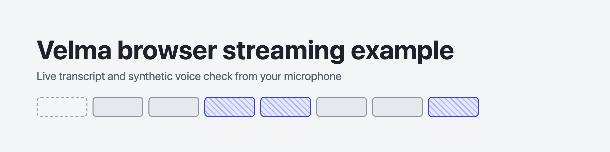
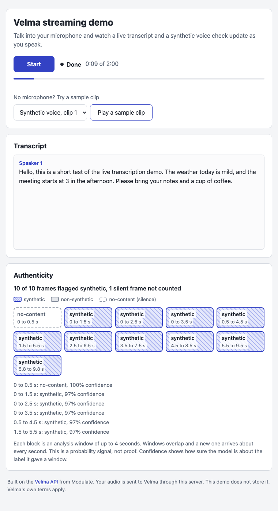
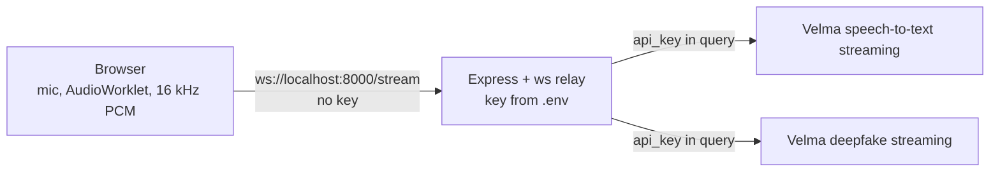
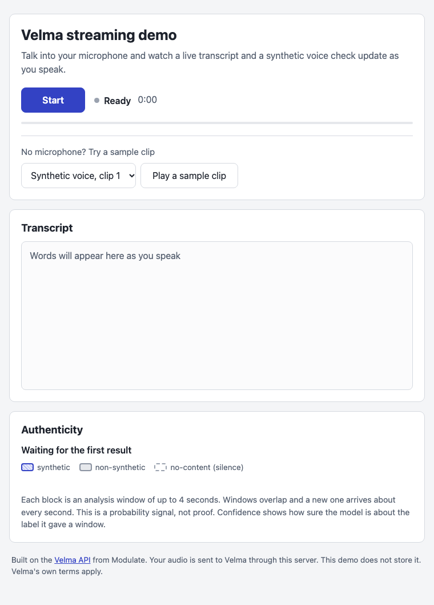
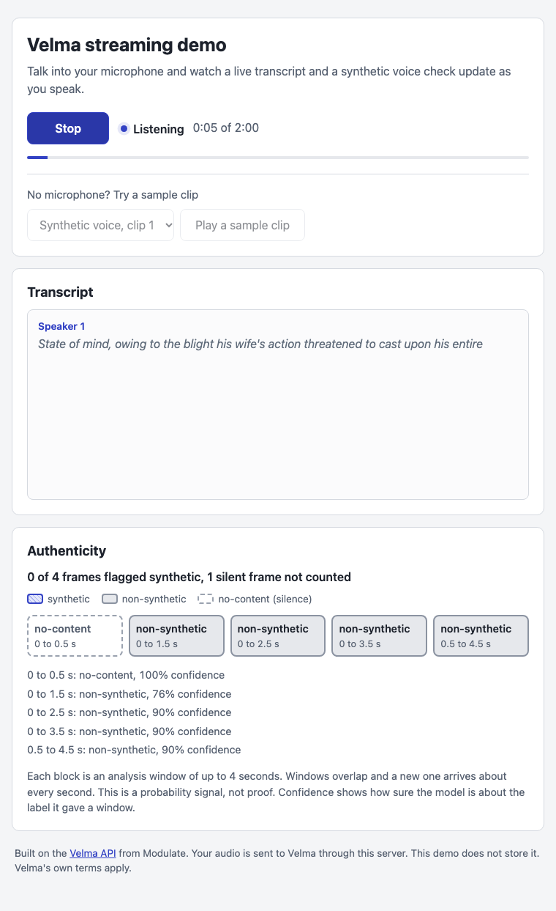
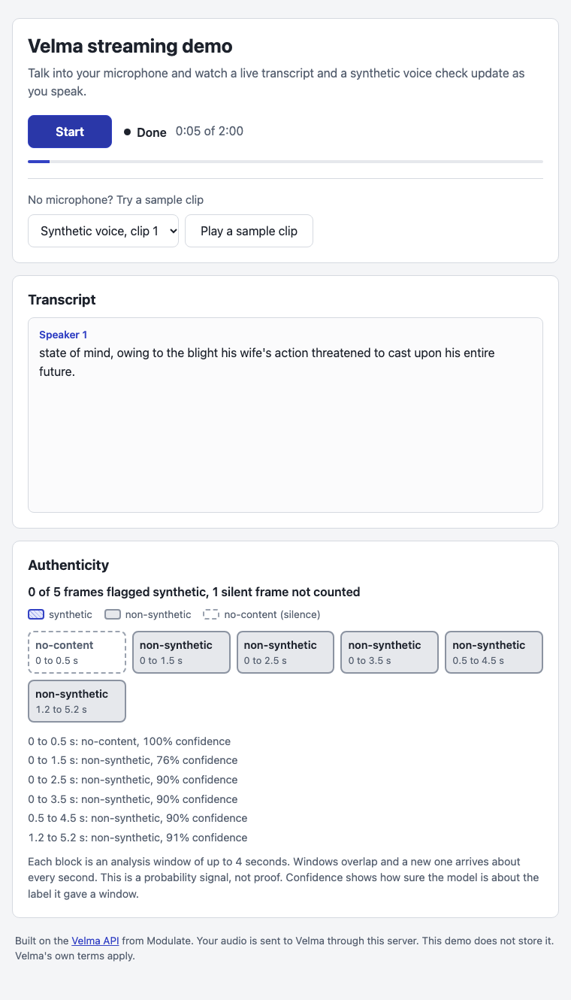
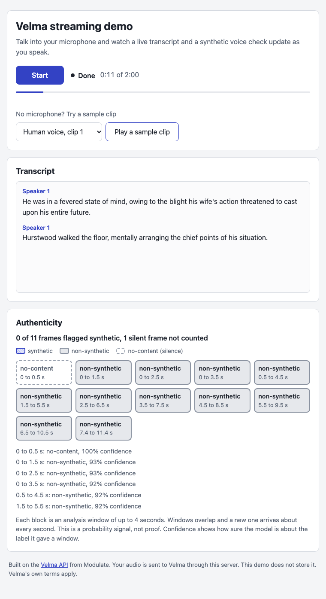

<p align="center">
  
</p>

# Velma browser streaming example

A small Node app. Open a page, click Start, talk into your microphone, and watch a live transcript (Velma speech-to-text streaming) and a synthetic voice check (Velma deepfake detection streaming) update as you speak. The Velma API key stays on the server.

<p align="center">
  
</p>

The screenshots come from real calls to Velma, not mock data. The one above plays a clip made with the macOS text-to-speech voice, so the clip is synthetic by construction.

> Demo only. Scores are estimates and are not proof.

## Run it

You need Node 20 or newer and a Velma API key from [platform.modulate.ai](https://platform.modulate.ai/signup-request).

```bash
git clone <this repo>
cd velma-browser-streaming-example
npm install
cp .env.example .env      # then put your Velma API key in .env
npm start
```

Open http://localhost:8000 and click Start. No microphone? Pick a clip in the sample list and click "Play a sample clip". It goes through the same pipeline.

## How it works



Velma's streaming endpoints take the API key as a query parameter, because a browser WebSocket cannot send custom headers. A key in the page would be visible to everyone who opens it. Velma has no scoped or short-lived browser tokens, so this repo does not mint tokens the way some other speech APIs do. The browser talks to a small relay on your server instead, and the relay adds the key.

For each browser session the relay opens one connection to each Velma model, forwards audio to both, and sends the replies back wrapped with a `source` of `stt` or `detect`. It says "ready" only when both connections are open.

Audio format: signed 16-bit little-endian PCM (`s16le`), 16 kHz, mono, in chunks of about 100 ms. The page asks for a 16 kHz audio context. If the browser cannot provide one, `public/pcm-worklet.js` downsamples by averaging samples and mixes channels to mono. Tested in Chromium. Firefox and Safari are not tested yet.

## What it shows

- A transcript with speaker labels. Partial text is lighter and is replaced by the final text for the same utterance.
- An authenticity strip with one block per result from Velma, labelled `synthetic`, `non-synthetic` or `no-content`, with the confidence on hover and in a list. Each block is an analysis window of up to 4 seconds. Windows overlap and a new one arrives about every second.
- A summary line, for example "10 of 10 frames flagged synthetic". Silent windows are not counted.

## Limits

- A default Velma account allows 3 concurrent connections per model. Each browser session uses one connection per model.
- Every second of audio spends credits. When credits run out, the page shows "The Velma account is out of credits".
- The relay adds its own caps. Change them with environment variables or in `src/config.js`:

| Setting | Default | Variable |
| - | - | - |
| Concurrent browser sessions | 2 | `MAX_SESSIONS` |
| Seconds per session | 120 | `MAX_SESSION_SECONDS` |
| Idle timeout in seconds | 15 | `IDLE_TIMEOUT_SECONDS` |
| Wait for Velma to connect, in seconds | 10 | `CONNECT_TIMEOUT_SECONDS` |
| New sessions per hour per IP | 100 | `MAX_SESSIONS_PER_HOUR_PER_IP` |
| Largest browser message in bytes | 65536 | `MAX_MESSAGE_BYTES` |
| Extra allowed origins | none | `ALLOWED_ORIGINS` |

When the demo is full, the page says so instead of failing silently. WebSocket upgrades from another origin are refused.

## Deploying

The relay needs a host that supports long-lived WebSocket servers, such as Render, Railway or Fly. Vercel serverless functions do not fit.

Anyone who hosts a public demo spends their own Velma credits. Keep the caps on. Set `TRUST_PROXY=1` behind a reverse proxy so the per-IP limit uses the real client address, and set `ALLOWED_ORIGINS` if the page is served from a different origin.

## Reuse the relay

`src/relay.js` has no Express dependency. `createRelay(config)` returns `handleUpgrade(req, socket, head)`, `activeSessions()` and `close()`.

```js
const { loadConfig } = require('./src/config');
const { createRelay } = require('./src/relay');

const relay = createRelay(loadConfig());
server.on('upgrade', (req, socket, head) => relay.handleUpgrade(req, socket, head));
```

For something other than a browser, for example a telephony bridge, connect any client that sends 16 kHz `s16le` binary frames, then an empty text frame to end the audio. Replies use the same wrapped format. Change the audio format in `src/config.js`.

## Security notes

- The key lives in `.env` (gitignored) or the `VELMA_API_KEY` environment variable. It is never sent to the browser.
- Velma's WebSocket URLs contain the key. The relay logs URLs with `api_key=***` and scrubs the key from every message it sends to the browser.
- The relay accepts only binary audio and the empty text frame from the browser, so a client cannot send Velma configuration frames. A session also stops if it sends more audio than the time limit allows.
- Logs hold client IP addresses and session timings, not audio or transcripts.
- Rotate any key that has been pasted into a chat, ticket or commit.

## Tests

```bash
npm test                      # relay unit tests with mock Velma servers
npm run test:failures         # wrong key, busy demo, 130 second session
npm run test:live             # real Velma API, needs VELMA_API_KEY
npm run test:e2e              # Playwright with a fake microphone, mock Velma
E2E_LIVE=1 npm run test:e2e   # same against the real API, rewrites docs/ screenshots
```

Install the browser once with `npx playwright install chromium`.

## Screenshots

All from `E2E_LIVE=1 npm run test:e2e`, using a fake microphone that plays `fixtures/real-1.wav` and the sample clip button.

| Ready | Listening |
| - | - |
|  |  |

| Done, microphone | Human sample clip |
| - | - |
|  |  |

## Links

- [Velma docs](https://docs.modulate.ai?utm_source=github&utm_medium=repo)
- [Speech-to-text streaming](https://docs.modulate.ai/api-reference/stt/streaming?utm_source=github&utm_medium=repo) and [deepfake detection streaming](https://docs.modulate.ai/api-reference/svd/streaming?utm_source=github&utm_medium=repo)
- [Authentication and rate limits](https://docs.modulate.ai/guides/authentication?utm_source=github&utm_medium=repo)

## Licence

MIT. See `LICENSE`. Modulate owns the Velma API and its trademarks. This example is an independent sample. Test clips are described in `fixtures/SOURCES.md`.
